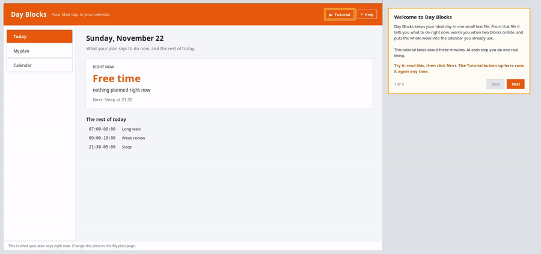
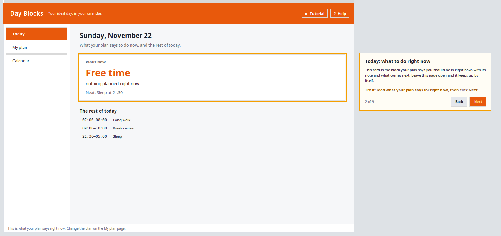
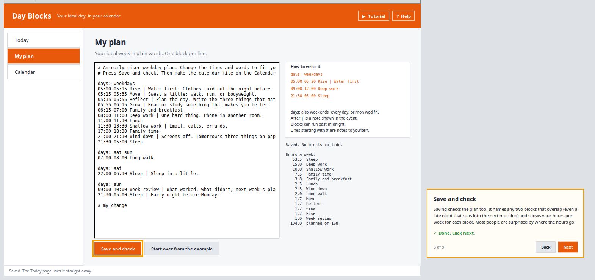
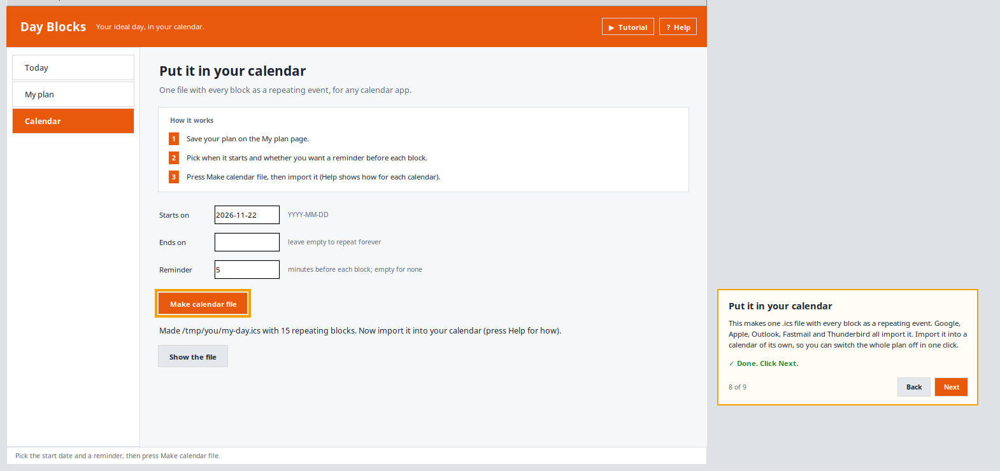

# Day Blocks

**Write your ideal day once, in plain words. See it in your calendar, and see what to do right now.**

Day Blocks turns a short text file into repeating events for any calendar (Google, Apple, Outlook, Fastmail, Thunderbird). It warns you when two blocks collide and shows where your week's hours actually go. Free, no account, works offline.



*The first time you open it, a three-minute tutorial has you edit the example plan, save and check it, and make your calendar file. ([Full video](docs/tutorial.mp4))*

---

## Why this exists

We wanted a daily rhythm in the calendar:
- wake up
- move
- reflect
- read
- family breakfast
- deep work
- admin
- a break
- family time
- wind down
- sleep

So that's what we did, by hand. It took fifteen separate repeating events, each made with clicks, each with its own time picker. Moving the morning meant editing every event after it, and nothing warned us when two blocks overlapped or when a late night ran into an early start.

Writing the same day as text takes two minutes:

```
days: weekdays
05:00 05:15 Rise | Water first.
05:15 05:35 Move
08:00 11:00 Deep work | One hard thing. Phone in another room.
21:30 05:00 Sleep
```

Changing a time is editing a number. A computer can check the text for collisions and add up the hours. So we built the small program that does those things, and nothing else.

## What it can replace

Day Blocks is built to be a free, simpler alternative for one job: a repeating ideal day.

| If you use… | It's good at… | What Day Blocks does instead |
|---|---|---|
| **Google Calendar / Apple Calendar** on their own | Showing your time, reminders on every device | Making fifteen repeating events by hand and keeping them in step is slow. Here you write the plan once, and Day Blocks makes all the events in one file you import. It works *with* your calendar, not instead of it. |
| **Sunsama** and other daily planners | Planning each day with your tasks | A paid subscription, and a new plan every morning. Day Blocks is for the rhythm that stays the same, written once. |
| **Motion, Reclaim** and other auto-schedulers | Letting software place your tasks | You give up control of your day, and pay monthly. Here you decide where every block goes, and the computer just checks it. |
| **Notion templates, spreadsheets** | A nice-looking routine page | A page doesn't remind you of anything. Day Blocks puts the routine where your reminders already are. |
| **A paper planner** | Thinking it through by hand | Paper can't check for overlaps or ping you at 9:30pm. Keep the paper for thinking, then copy the result here once. |

## How it helps, and how much

Three ideas from research sit behind it:
- **Plans tied to a time and place get done more often.** "When it's 8:00, I start deep work" is an *if-then plan*. The early meta-analysis found a medium-to-large effect (Gollwitzer & Sheeran 2006). A 2024 re-analysis of 642 tests, corrected for publication bias, found a smaller but real one (Sheeran, Listrom & Gollwitzer 2024). A calendar block is an if-then plan with a reminder attached.
- **We all expect things to take less time than they do.** This is the *planning fallacy* (Buehler, Griffin & Ross 1994). `check` adds up your planned hours per week, so you see a plan that doesn't fit *before* you live it.
- **Fewer decisions in the moment.** If the plan already says what 8:00 is for, there's nothing to decide at 8:00.

Time blocking as a method has little direct research of its own. We don't claim more than that the pieces above are sound.

## Start

You need Python 3.9 or newer, and nothing else.

```
git clone https://github.com/sebaytlabs/day-blocks
cd day-blocks
python3 day_blocks_app.py
```

The first time, a **tutorial** runs by itself:
1. See what your plan says for right now.
2. Change the example plan into yours.
3. Save and check it.
4. Make your calendar file.

The **▶ Tutorial** button runs it again any time, and **F1** explains any page.

The app has three pages:
- **Today:** what your plan says to do right now, with its note, and the rest of today. It refreshes itself, so you can leave it open.
- **My plan:** write and edit the plan, with a guide beside it. **Save and check** warns about blocks that collide and shows your hours per week.
- **Calendar:** pick a start date and a reminder, then make the `.ics` file.

Your plan is kept in `~/.day-blocks/plan.txt` (set `DAY_BLOCKS_HOME` to keep it elsewhere).

**Tip:** import the file into a *calendar of its own* ("My day"). Then you can switch the whole plan off for a holiday in one click, or delete it and import a new version when your plan changes.

## What it looks like from the command line

```
days: weekdays
05:00 05:15 Rise | Water first. Clothes laid out the night before.
05:15 05:35 Move
08:00 11:00 Deep work | One hard thing. Phone in another room.
21:30 05:00 Sleep

days: sat sun
07:00 08:00 Long walk
```

```
$ python3 dayblocks.py ics plan.txt --alarm 5
plan.ics: 5 repeating blocks from 2026-11-23. Import it into your calendar.

$ python3 dayblocks.py check plan.txt
Hours a week:
   37.5  Sleep
   15.0  Deep work
    2.0  Long walk
    1.7  Move
    1.2  Rise
   57.4  planned of 168

$ python3 dayblocks.py now plan.txt
Now:  Deep work  (until 11:00)
      One hard thing. Phone in another room.
Next: Sleep at 21:30
```

If two blocks collide, `check` names them and the line numbers, including a late night that runs into the next morning:
`Monday: 'Sleep' (line 4) runs into 'Rise' (line 2) by 15 min`.

## From the command line

You need Python 3.9 or newer, and nothing else.

```
git clone https://github.com/sebaytlabs/day-blocks
cd day-blocks
cp examples/early-riser.txt my-day.txt        # edit it
python3 dayblocks.py check my-day.txt
python3 dayblocks.py ics my-day.txt --start 2026-12-01 --alarm 5
```

Then import `my-day.ics`:
- **Google Calendar:** Settings > Import. Make a separate calendar for it first, so you can switch it off in one click.
- **Apple Calendar:** File > Import.
- **Outlook, Fastmail and Thunderbird:** they all take `.ics` files.

Changed your plan? Delete that calendar and import the new file. Because the blocks live in their own calendar, that's one click.

## The plan file

| Line | Meaning |
|---|---|
| `days: weekdays` | the blocks below repeat Monday to Friday. Also `weekends`, `every day`, or a list like `mon wed fri` |
| `05:00 05:15 Rise` | a block from 5:00 to 5:15 called Rise |
| `... Rise \| Water first.` | everything after `\|` is the note inside the event |
| `21:30 05:00 Sleep` | blocks can run past midnight |
| `# ...` | a comment |

### Options for `ics`

| Option | What it does |
|---|---|
| `--start` | the date the blocks start (default today) |
| `--until` | the date they stop (default: they repeat forever) |
| `--alarm MIN` | a reminder that many minutes before each block |
| `--tz America/Chicago` | pin the times to one time zone. Without it, times follow you when you travel. |
| `--out FILE` | where to write the file |

## Why plain text

- **You can read it in one glance.** A plan you can read in one glance is a plan you'll keep.
- **Changing it is fast.** Five minutes in a text editor beats dragging 15 events around a calendar.
- **It lives wherever you want:** in your notes, in git, or on paper.
- **It shows where the hours go.** `check` shows where the week's hours actually go, and that's usually the real surprise.

## Screenshots


*Today: what your plan says to do right now.*


*My plan: Save and check shows collisions and your hours per week.*


*Calendar: one .ics file for Google, Apple, Outlook and the rest.*

## Related tools

- **[SimpleBrain](https://github.com/sebaytlabs/simplebrain).** A notes app with a calendar, tasks and a Today page that hands you three things a day. Day Blocks is the fixed rhythm, and SimpleBrain holds what changes.
- **[Learning Kit](https://github.com/sebaytlabs/learning-kit).** Give your reading a block here, and its sittings have a home.

## Limits, plainly

- One plan for every week. Alternating weeks or shift work need two plan files.
- The calendar file is a snapshot. Change the plan and you import a new file (delete the old calendar first).
- `now` uses your computer's clock and time zone.

## Sources

- Buehler, R., Griffin, D., & Ross, M. (1994). Exploring the "planning fallacy". *Journal of Personality and Social Psychology*, 67(3), 366–381.
- Gollwitzer, P. M., & Sheeran, P. (2006). Implementation intentions and goal achievement: a meta-analysis. *Advances in Experimental Social Psychology*, 38, 69–119.
- Sheeran, P., Listrom, O., & Gollwitzer, P. M. (2024). The when and how of planning: meta-analysis of the scope and components of implementation intentions in 642 tests. *European Review of Social Psychology*. doi:10.1080/10463283.2024.2334563

## Tests

```
python3 dayblocks.py --selftest
```

## License

MIT. Made by [Sebayt Labs](https://sebaytlabs.com). We build free tools when the usual ones are too expensive, too complicated, or don't do the job.
